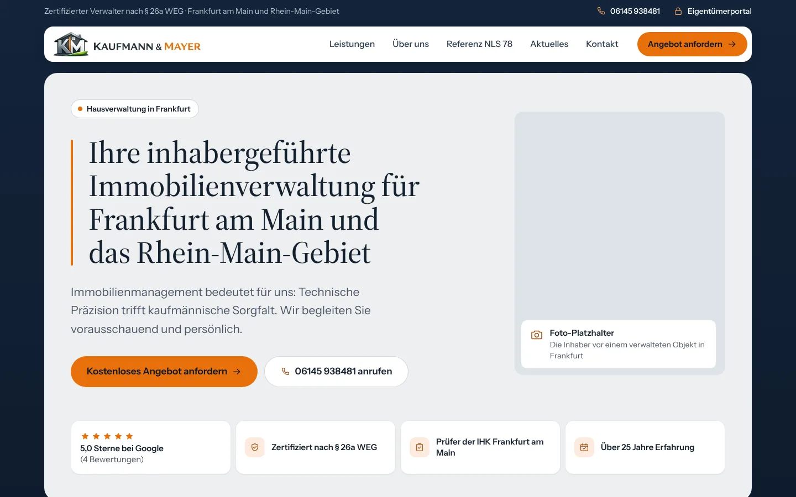
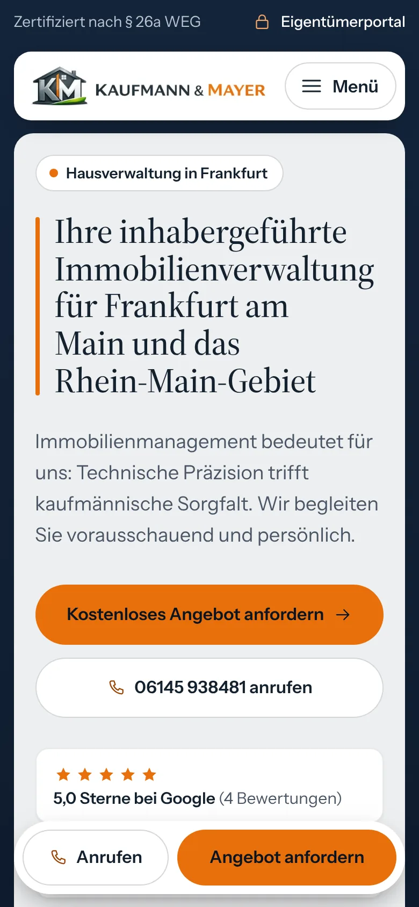
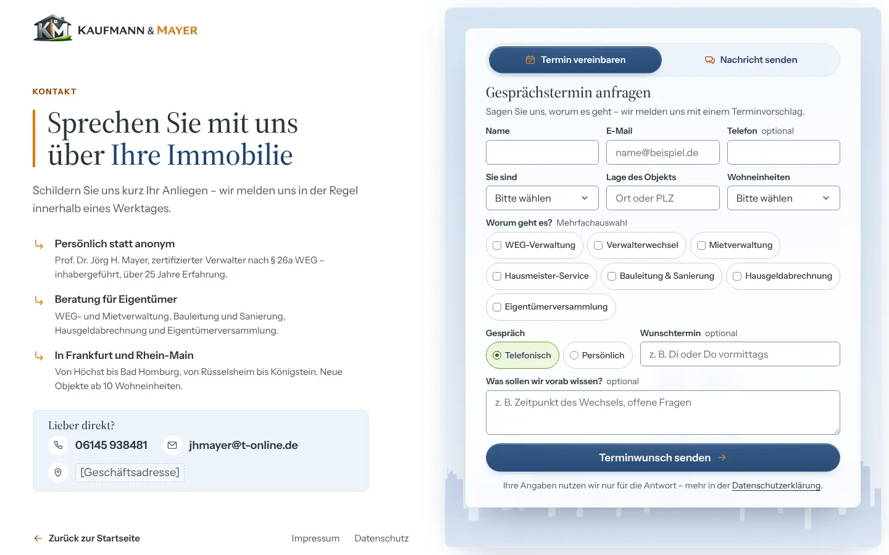
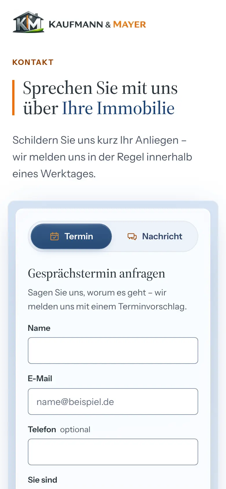

# Kaufmann & Mayer – neue Startseite

Entwurf der neuen Startseite und der Kontaktseite `/anfrage` für die Hausverwaltung Kaufmann & Mayer OHG,
Frankfurt am Main. Gedacht als Pitch an den Inhaber: Er soll zeigen, dass ein
schneller, logisch aufgebauter Auftritt mehr Reichweite bei Google und mehr
Mandatsanfragen bringt als die heutige Wix-Seite.

Statisches HTML und CSS, ein Skript (12 KB, komprimiert 4,6 KB), kein Baukasten, kein
Build-Schritt, deploybar auf Cloudflare Pages; das Anfrageformular verschickt
über eine Pages Function (Resend) E-Mails. Inhalte und Logo stammen von
[kaufmann-mayer.de](https://www.kaufmann-mayer.de); Layout, Farben, Schriften
und Bildsprache sind neu: hell und ruhig (Weiß und kühles Blau), dazu genau
die Logofarben – Schiefer für Text und Buttons, Orange und Grün als Signalfarben
im Wechsel –, leicht abgerundete Elemente, die Frankfurter Skyline im Hero, eine
animierte und eine interaktive Grafik sowie ein bedienbares Portal-Fenster. Als Stilreferenz diente
[relaxa-immobilien.de](https://relaxa-immobilien.de/) (Struktur, Ruhe,
Grafiken) – übernommen wurde die Haltung, nicht die Gestaltung.

| Desktop 1440 px | Mobil 390 px |
|---|---|
|  |  |

Ganze Seite: [Desktop](screenshots/startseite-1440.webp) ·
[Mobil](screenshots/startseite-390.webp)

| Kontaktseite `/anfrage`, Desktop 1440 px | Mobil 390 px |
|---|---|
|  |  |

## Lighthouse

Gemessen am 15.10.2026 (aktueller Stand: Kontaktseite `/anfrage`, Laufband, blaue Glas-Pillen, Skyline nach Vorlage, Werterhalt-Animation) mit Lighthouse 12.8.2 (Chromium aus Playwright 1.56,
simulierte Drosselung) gegen den lokalen Testserver, der Routing, Header und
Komprimierung von Cloudflare Pages nachbildet. Je drei Läufe, angegeben ist der
Median.

| | Ziel | Startseite mobil | Startseite Desktop | `/anfrage` mobil | `/anfrage` Desktop |
|---|---|---|---|---|---|
| Leistung | ≥ 90 | **100** | **100** | **100** | **100** |
| Barrierefreiheit | ≥ 95 | **100** | **100** | **100** | **100** |
| Best Practices | – | 100 | 100 | 100 | 100 |
| SEO | 100 | **100** | **100** | **100** | **100** |
| Largest Contentful Paint | < 2,5 s | **1,58 s** | 0,34 s | **1,51 s** | 0,37 s |
| Cumulative Layout Shift | < 0,1 | **0,000** | 0,000 | **0,000** | 0,000 |
| First Contentful Paint | – | 0,91 s | 0,27 s | 0,98 s | 0,26 s |
| Total Blocking Time | – | 0 ms | 0 ms | 0 ms | 0 ms |
| Übertragene Daten | – | 107 KB | 103 KB | 95 KB | 91 KB |

Mobil schwankt die Leistung der Startseite zwischen den Läufen leicht (zuletzt
98, 100, 100; früher einmal 97). Live auf Cloudflare können die Werte etwas anders
ausfallen; nach dem Livegang einmal mit PageSpeed Insights gegenprüfen.

Zusätzlich grün: axe-core ohne Befund (WCAG 2.0–2.2 AA, mit offenem und
geschlossenem Mobilmenü, auf `/anfrage` in allen Zuständen des Formulars), kein
waagerechtes Scrollen von 360 bis 1920 px, alle Klickflächen ≥ 44 × 44 px,
kleinster gemessener Textkontrast 4,72:1 (Startseite) und 4,85:1 (`/anfrage`),
Formular mit und ohne JavaScript bis zur versendeten Mail (32 Prüfpunkte).

## Starten

Voraussetzung: Node.js ab 18.

```bash
node tools/server.js            # http://localhost:8788
```

Der Testserver bildet Cloudflare Pages nach: saubere URLs ohne `.html`,
`404.html` für unbekannte Pfade, Header aus `site/_headers`, gzip. Functions
führt er nicht aus – das Formular bietet lokal deshalb die vorbereitete E-Mail
an (wie auf GitHub Pages); die Function selbst prüft `formular.js`. Ein
beliebiger anderer statischer Server (`npx serve site`) zeigt die Seite
ebenfalls an, aber ohne diese Eigenschaften.

## Bauen

Es gibt keinen Build-Schritt – `site/` ist die fertige Website. Drei Skripte
erzeugen Grafiken neu, falls sich Logo, Seitentitel oder Skyline-Vorlage ändern:

```bash
python3 -I tools/assets/logo.py       # Logo (AVIF/WebP/PNG, 1x–3x), Emblem, Favicon, Touch-Icon
node tools/assets/og-bild.js          # Vorschaubild zum Teilen: site/img/og-image.jpg
python3 -I tools/assets/skyline.py    # Skyline-Silhouette aus quellen/skyline-vorlage.png
```

`logo.py` braucht eine aktuelle Pillow-Version mit AVIF-Unterstützung, `og-bild.js`
Playwright (`npm i -g playwright`), `skyline.py` OpenCV
(`pip install opencv-python-headless`). Die Skyline schreibt ein `<svg>` nach
`tools/assets/skyline.svg.html`; es ersetzt das `svg.hero__skyline` in
`site/index.html`.

## Prüfen

```bash
cd tools && npm ci && cd ..           # einmalig: axe-core, Lighthouse
node tools/pruefung/alle.js           # alle Prüfungen inkl. Lighthouse, ca. 2 min
node tools/pruefung/alle.js seo a11y  # nur einzelne
node tools/server.js &                # für Bilder zum Ansehen:
node tools/pruefung/screenshots.js    # Startseite und /anfrage, 390 und 1440 px
node tools/pruefung/ausschnitt.js .wh-venn --breiten 768,1024 --zeiten 300,2600   # ein Element, Hover, Animation
node tools/pruefung/ausschnitt.js .formular-karte --pfad /anfrage --breiten 390,1024 # dasselbe auf /anfrage
python3 -I tools/screenshots-webp.py  # Momentaufnahmen in screenshots/ erneuern
python3 -I tools/vorschau.py          # Einzeldatei-Vorschau (Startseite und /anfrage) für den Auftraggeber
```

Was jede Prüfung abdeckt, steht im Skill `.claude/skills/aenderung-pruefen/`.
Welche Seiten geprüft, fotografiert und in die Vorschau gebaut werden, steht in
`tools/seiten.json`; `seo.js` wird rot, wenn eine Seite in `site/` dort fehlt
(neue Seite dort eintragen).
`grafik.js` misst die Geometrie der Werterhalt-Grafik (Begriffe im Kreis,
Titel in der Schnittmenge); `formular.js` prüft die Pages Function ohne Netz
(Resend nachgebildet) und das Formular im Browser mit und ohne JavaScript. Die
Vorschau bettet Schriften, Bilder, CSS und JavaScript je Seite in eine Datei
ein, die ohne Server im Browser läuft; die beiden Dateien verlinken einander.
Lighthouse-Berichte (HTML und JSON) landen in `tools/berichte/`.

## Vorschau auf GitHub Pages

Der Workflow `.github/workflows/pages.yml` veröffentlicht `site/` bei jedem Push
auf den Arbeitsbranch (oder `main`) unter

**https://sempergo.github.io/KaufmannMayer/** · Kontaktseite:
**https://sempergo.github.io/KaufmannMayer/anfrage**

`tools/pages.py` stellt dafür alle Wurzelpfade (`/css/…`, `/img/…`, `/`) auf den
Unterpfad `/KaufmannMayer/` um und sperrt die Kopie für Suchmaschinen
(`noindex`, `robots.txt`), damit sie der späteren Domain keine Konkurrenz macht.
`_headers` gilt dort nicht (keine CSP), und Functions gibt es dort nicht: Das
Formular bietet nach dem Absenden die vorbereitete E-Mail an. Maßgeblich für
den Livegang bleibt Cloudflare Pages.

**Eingerichtet am 15.10.2026:** Repo öffentlich, *Settings → Pages → Build and
deployment → Source: „GitHub Actions“* (öffentlich stellen allein schaltet Pages
nicht ein). Seitdem geht jeder Push mit Änderungen in `site/` automatisch
online; per Hand unter *Actions → GitHub Pages → Run workflow*.

```bash
python3 -I tools/pages.py /KaufmannMayer   # lokal nachbauen nach _pages/
```

## Deployen auf Cloudflare Pages

**Variante A – mit Git (empfohlen).** Im Cloudflare-Dashboard unter
*Workers & Pages → Erstellen → Pages → Mit Git verbinden* dieses Repository
wählen und einstellen:

| Einstellung | Wert |
|---|---|
| Framework-Voreinstellung | Keine |
| Build-Befehl | *(leer lassen)* |
| Ausgabeverzeichnis | `site` |
| Produktionszweig | `main` |

Jeder Push auf `main` geht dann live, jeder andere Zweig bekommt eine
Vorschau-URL. Den Ordner `functions/` (Anfrageformular) findet Cloudflare im
Repo-Wurzelverzeichnis von selbst; für den Mailversand einmalig Resend und die
Variablen einrichten: **[ANFRAGE-SETUP.md](ANFRAGE-SETUP.md)**.

**Variante B – Direkt-Upload** ohne Git-Anbindung:

```bash
npx wrangler login
npx wrangler pages deploy site --project-name=kaufmann-mayer   # aus dem Repo-Wurzelverzeichnis, dann kommt functions/ mit
```

**Eigene Domain:** im Pages-Projekt unter *Benutzerdefinierte Domains*
`www.kaufmann-mayer.de` hinzufügen und `kaufmann-mayer.de` per Weiterleitung
auf `www` schicken (Canonical, Sitemap und strukturierte Daten nutzen `www`).

> **Vor dem Umstellen der Domain:** Die heutige Wix-Seite hat indexierte
> Unterseiten. Jede davon muss auf der neuen Seite existieren oder per
> `site/_redirects` (301) weitergeleitet werden, sonst gehen Rankings verloren:
> `/weg-verwaltung-frankfurt`, `/referenz-nls-78`, `/hausverwaltung-frankfurt`,
> `/news`, `/kundenportal`, `/kontakt`, `/impressum`, `/datenschutz`,
> `/cookies`. Bis dahin landen Links auf diese Seiten auf `404.html`.
> `/kontakt` gehört per 301 auf die neue Kontaktseite `/anfrage`
> (`/kontakt /anfrage 301` in `site/_redirects`).

## Aufbau

```
site/                     Website (Ausgabeverzeichnis für Cloudflare Pages)
  index.html              Startseite
  anfrage.html            Kontaktseite mit Formular (Termin oder Nachricht)
  404.html                Fehlerseite (noindex)
  css/site.css            Design-Tokens und alle Stile
  js/site.js              Mobilmenü, aktiver Menüpunkt, Portal-Reiter, Werterhalt-Animation, Laufband, Anfrageformular (einziges Skript)
  fonts/                  Source Serif 4 (Display, 500), Instrument Sans (variabel), nur latin
  img/                    Logo 1x–3x als AVIF/WebP/PNG, Emblem für die Netzwerk-Grafik, og-image.jpg
  _headers                Sicherheits-Header (CSP) und Cache-Regeln
  _redirects              301-Weiterleitungen alter Adressen (/kontakt → /anfrage)
  robots.txt, sitemap.xml, llms.txt, favicon.ico, apple-touch-icon.png
functions/api/anfrage.js  Pages Function: Formular → E-Mail über Resend (Einrichtung: ANFRAGE-SETUP.md)
quellen/                  Original-Logo von der Wix-Seite, Skyline-Vorlage
tools/                    Testserver, Prüfungen, Asset-Skripte (eigenes package.json)
screenshots/              Momentaufnahmen bei 390 und 1440 px (Startseite, /anfrage)
.claude/skills/           Skillbase aus dem 21Layer-Repo, siehe SKILLS.md
```

Der Stack folgt dem 21Layer-Repo: statisches HTML ohne Build-Schritt,
selbst gehostete Schriften, Cloudflare Pages, Prüfungen mit Playwright. Einziger
Unterschied: Die Website liegt in `site/` statt im Wurzelverzeichnis. So
werden README, Skills und Werkzeuge gar nicht erst ausgeliefert, und es braucht
keine Sperre über Functions.

## Seitenaufbau und Aufgabe jeder Sektion

| # | Sektion | Aufgabe |
|---|---|---|
| 1 | Kopfzeile mit Infoleiste | Vertrauen (§ 26a WEG), Telefon, Weg zum Portal, Anfrage immer erreichbar |
| 2 | Hero mit Vertrauensleiste | in Sekunden klar: wer, wo, wofür; zwei Wege zur Anfrage; Google-Bewertung, Zertifizierung, IHK, Erfahrung |
| 3 | Steuerberater trifft Ingenieur | Vertrauen durch zwei Inhaber mit klaren Zuständigkeiten – Abgrenzung zur Großverwaltung |
| 4 | Alleinstellungsmerkmale | Leistung erklären: was anders ist als bei anderen Verwaltungen |
| 5 | 360-Grad-Leistungsumfang | Leistung erklären, interne Links auf die fünf Leistungsseiten, Kachel „Verwalterwechsel“ führt zur Anfrage |
| 6 | Referenz NLS 78 | Vertrauen durch ein großes, konkretes Objekt |
| 7 | Eigentümerportal | Bestandskunden schnell ans Ziel, zeigt digitale Arbeitsweise |
| 8 | Servicepartner | Vertrauen durch regionale Partner |
| 9 | Anfrage / Kontakt | zur Anfrage führen: großer Button, Telefon, Ansprechpartner, Antwortzeit |
| 10 | Footer | Orientierung, Rechtliches, Einsatzgebiet für die lokale Suche |

Mobil bleibt die Reihenfolge; die Leistungs-Kacheln stehen untereinander, die
Vertrauensleiste rückt direkt unter die Buttons, die Grafiken reichen bis an den
Boxrand, in der Werterhalt-Animation stehen die Begriffe mobil als Liste unter
den Kreisen, das Portal-Fenster stapelt Reiter und Inhalt, und eine
freistehende weiße Leiste unten hält „Anrufen“ und „Termin vereinbaren“ im
Griff. Die Skyline liegt mobil hinter der Überschrift statt hinter dem
Fließtext.

### Kontaktseite `/anfrage`

Aufbau nach dem 21Layer-Anfrageformular, Gestaltung und Inhalte von Kaufmann &
Mayer. Die Texte links stammen von der heutigen Kontaktseite
(kaufmann-mayer.de/kontakt): Antwort innerhalb eines Werktages, die
Beratungsthemen, Prof. Dr. Jörg H. Mayer als Ansprechpartner, das Einsatzgebiet,
neue Objekte ab 10 Wohneinheiten.

| Bereich | Aufgabe |
|---|---|
| Kopf | nur das Logo oben links (zur Startseite) – keine Leiste, keine Navigation, damit nichts vom Formular ablenkt |
| Einleitung | Eyebrow „Kontakt“, H1 mit dem orangen K|M-Strich, Antwortzeit |
| Formular | Umschalter **Termin vereinbaren / Nachricht senden**; Name, E-Mail (Pflicht), Telefon, „Sie sind“ (Eigentümer, Beirat, Vermieter), „Worum geht es?“ als Mehrfachauswahl (WEG-Verwaltung, Verwalterwechsel, Mietverwaltung, Hausmeister-Service, Bauleitung & Sanierung, Hausgeldabrechnung, Eigentümerversammlung), Lage des Objekts, Wohneinheiten; im Terminweg zusätzlich Gesprächsart und Wunschtermin; Nachricht |
| Punkte | persönlicher Ansprechpartner, Beratungsthemen, Einsatzgebiet – als ↳-Liste wie in der Vorlage |
| Direkt | Telefon und E-Mail in einer kleinen Karte |
| Fuß | „Zurück zur Startseite“, Impressum, Datenschutz |

Ab 960 px steht alles auf einem Bildschirm (geprüft bei Fensterhöhen ab
800 px: 1280 × 800, 1440 × 800/900, 1920 × 960): links Text, rechts ab genau der
Mitte die hellblaue Fläche mit der Skyline und der weißen Glaskarte des
Formulars, Felder zu dritt in einer Reihe. Bei niedrigen Fenstern bleibt die
Zwischenüberschrift der Karte nur für Screenreader stehen, Fehlerhinweise
stehen neben dem Label statt darunter. Schmaler (Tablet, Handy) untereinander:
Einleitung, Formular, Punkte. „Termin vereinbaren“ auf der Startseite führt auf `/anfrage`,
„Kontakt aufnehmen“ auf `/anfrage#nachricht` (öffnet den Weg „Nachricht“).

## Designsystem

Alle Werte stehen als CSS-Variablen am Anfang von `site/css/site.css`.

| Token | Wert | Einsatz |
|---|---|---|
| `--white` / `--bg-soft` | `#ffffff` / `#f4f7fb` | Seitengrund und weiße Boxen / Off-White für Leisten im Portal |
| `--bg-blau` | `#eef3fa` | blaue Boxen; Kacheln und Karten in weißen Boxen |
| `--bg-tint` / `--hero-oben` | `#eaf1fa` / `#d6e3f3` | Icon-Kreise / Beginn des Hero-Verlaufs |
| `--schiefer` | `#28353e` | Logo (Schriftzug, Haus): Text (12,6:1), Überschriften, Karte „Verwalterwechsel“ |
| `--blau-800` | `#1a4274` | Primärbuttons (weiße Schrift 10:1) |
| `--schiefer-tief` | `#1c262d` | Schrift auf Orange (5,1:1) |
| `--blue-600` / `--navy-700` | `#2a5ea8` / `#2c4266` | Skyline, Schnittmenge „Werterhalt“ / Icons |
| `--slate-600` | `#4a5666` | Nebentext (7,5:1) |
| `--orange-500` / `--orange-400` | `#ec720f` / `#ec932d` | Logo („MAYER“, K|M-Strich): Akzent, Akzentbutton |
| `--orange-700` | `#9a4308` | Orange als Text und Fokusrahmen (6,6:1) |
| `--gruen-500` / `--gruen-400` / `--gruen-900` | `#61a210` / `#94c014` / `#174215` | Logo (Bogen): Akzent, Lichtkante, Kreis „Kaufmännisch“ |
| `--gruen-700` | `#35700d` | Grün als Text (6,0:1), z. B. Titel der Inhaber |
| `--akzent` (+ `-text`, `-hell`, `-leucht`) | Orange, mit `.akzent-gruen` Grün | Signalfarbe eines Abschnitts |
| `--line` | `#dfe5ee` | feine Linien und Kartenränder |
| `--r-sm` / `--r` / `--r-lg` / `--r-box` | 4 / 6 / 8 / 12 px | leicht abgerundete Ecken; 12 px für Boxen und Leisten |
| `--box-pad` / `--box-gap` | 16–64 px / 12–20 px | Innenabstand der Boxen, Abstand zwischen ihnen |
| `--glow` | weicher blauer Schein | hinter jeder Box, hinter der Kontakt-Box etwas kräftiger |
| `--rand-feld` | `#8492a4` | Rand der Eingabefelder und Auswahlkästchen (3,2:1, WCAG 1.4.11) |
| `--rot-700` | `#b42318` | Fehlerhinweise im Formular (6,6:1) |

- **Struktur:** Hero ganzflächig im Blauverlauf; alle Abschnitte danach als
  leicht abgerundete Boxen auf weißem Grund mit leichtem Schein dahinter, im
  Wechsel weiß und blau: Über uns (weiß), Stärken (blau), Leistungen (weiß),
  Referenz (blau), Portal (weiß), Partner (blau), Kontakt (kräftigerer
  Blauverlauf). Weiße Boxen tragen ihr Blau in einem Verlauf oben rechts und in
  den Karten. Inhalte im 12-Spalten-Raster (max. 1200 px).
- **Signalfarben aus dem Logo:** jeder Abschnitt hat eine Akzentfarbe – Orange
  (Über uns, Leistungen, Kontakt) oder Grün (Stärken, Referenz, Portal,
  Partner). Sie färbt die Eyebrow-Zeile über der H2, Linien, Häkchen, Punkte
  und die Hover-Effekte. Gemischt wird bewusst an einzelnen Stellen: im Hero
  der orange Strich an der H1 und grüne Icons in der Vertrauensleiste, bei den
  Inhabern das Fachgebiet in Orange und der Titel unter dem Namen in Grün, im
  Portal orange Markierung und grüne Häkchen, in der Animation Grün, Orange und
  die blaue Schnittmenge.
- **Vertrauensleiste (Hero):** dezentes Laufband ohne Rahmen – Bewertung,
  Zertifizierung, IHK-Prüfer und Erfahrung mit kleinen grünen Icons laufen
  langsam (48 s je Durchgang) und blenden an der Kante der Abschnitte aus, nicht
  am Bildschirmrand. Ohne sichtbaren Knopf (Wunsch des Auftraggebers)
  anhaltbar, weil Bewegung, die von selbst startet, das sein muss (WCAG 2.2.2):
  Überfahren hält an, Antippen schaltet um, mit der Tastatur ist das Band ein
  Tab-Halt und steht, solange es ausgewählt ist. Ohne JavaScript und bei
  reduzierter Bewegung steht die Leiste als umbrechende Zeile. Die Liste ist für Screenreader einmal da; die
  Kopie für den nahtlosen Lauf ist verborgen.
- **Navigation:** freistehende weiße Leiste mit abgerundeten Ecken und weichem
  Schatten; sie bleibt beim Scrollen mit etwas Abstand zum Fensterrand stehen,
  der Inhalt läuft sichtbar darunter durch. Der Menüpunkt der sichtbaren
  Sektion bekommt einen orangen Strich. Darüber eine schlichte Infozeile auf
  dem Hero-Verlauf. Das Mobilmenü öffnet als eigene Box unter der Leiste.
- **Buttons:** Glas-Pillen – primär dunkles Blau (`--blau-800`, zu 92 %
  deckend, Hintergrund weich gezeichnet, sanftes Licht von oben, nur eine
  feine helle Kante, kleiner Schatten), weiße Schrift und oranger Pfeil; sekundär weißes Milchglas mit feinem
  blauem Ring; einmal Orange als Akzent (Karte „Verwalterwechsel geplant?“).
  Auch der Menüknopf ist eine Pille; Boxen und Karten bleiben leicht abgerundet. Texte: „Termin vereinbaren“
  (Hero, Kontakt, Schnellleiste) und „Kontakt aufnehmen“ (Navigation, Karte
  „Verwalterwechsel“). Beim Überfahren hellt die Fläche auf, ein Pfeil rückt
  3 px nach rechts.
- **Grafiken (inline SVG und HTML, keine Bilddateien):**
  Hero – die Frankfurter Skyline als blaue Silhouette groß im Hintergrund,
  nachgezeichnet aus der gelieferten Vorlage (`quellen/skyline-vorlage.png`,
  mit Europaturm, Messeturm und Commerzbank Tower). Sie reicht über die ganze
  Hero-Breite, läuft links über den Rand hinaus und blasst nach unten (ohne
  Kante) und nach rechts aus; mobil liegt sie hinter der Überschrift. Die
  Hero-Texte haben einen weichen hellen Schein, damit die Silhouette an den
  Buchstaben zurücktritt.
  „Steuerberater trifft Ingenieur“ – Werterhalt-Animation nach der gelieferten
  Vorlage `werterhalt-venn.html`, Mechanik unverändert: Die Kreise
  „Kaufmännisch“ (Grün) und „Technisch“ (Orange) zeichnen sich – ein
  Leuchtpunkt läuft an der Zeichenspitze mit –, Verlaufsflächen und ein feiner
  gestrichelter Innenring blenden ein, die Begriffe erscheinen als Milchglas-
  Pillen mit eigenem Icon. Beim Zusammenrücken drehen sich die Innenringe
  gegeneinander, ein Bodenschatten verdichtet sich, die Schnittmenge färbt sich
  blau und bekommt eine blaue Umrandung, ein Pulsring läuft aus, und ein
  Abzeichen zeichnet das Logo im Kleinen – Haus, oranger K|M-Strich, grüner
  Bogen – in einem blauen Ring; darunter „Werterhalt Ihrer Immobilie“. Die
  Kreise rücken nur so weit zusammen (165 Einheiten je Kreis), dass die
  Begriffe mit mindestens 12 px Abstand mitten in ihrer Sichel liegen und
  „Werterhalt“ in die Schnittmenge passt – gemessen mit
  `tools/pruefung/grafik.js`. Läuft einmal (gut 3 s), sobald
  die Grafik zur Hälfte im Bild ist. Angepasst an die Seite: lokale Schriften
  statt Google Fonts (DSGVO), alle Inline-Styles als Klassen (CSP), Skript in
  `js/site.js`, Endbild ohne JavaScript und bei reduzierter Bewegung, eigene
  Mobilfassung.
  „Regional vernetzt“ – das Logo in der Mitte, verbunden mit Eigentümern,
  Beirat, Kanzleien, Notaren, Handwerk und Portal; beim Überfahren leuchtet die
  jeweilige Verbindung grün. Beide zeigen nur Inhalte aus den Texten.
- **Portal-Fenster (Sektion 7):** schematisches, bedienbares Fenster mit fünf
  Reitern (Abrechnungen, Protokolle, Einladungen, Schäden, Termine). Überfahren,
  Antippen oder Pfeiltasten wählen den Bereich; eine weiße Markierung gleitet
  zum Reiter, der Inhalt blendet gestaffelt ein, Platzhalterzeilen ziehen sich
  auf, im Kalender pulsiert der gewählte Tag einmal. Umgesetzt als Tabs nach
  WAI-ARIA (Rollen, aria-selected, wandernder Fokus); ohne JavaScript sind die
  Reiter deaktiviert und der erste Bereich steht da.
- **Formular (`/anfrage`):** weiße Felder mit 6 px Rundung und kräftigerem
  Rand (`--rand-feld`), beim Fokus blauer Rahmen mit weichem Hof. Auswahl als
  Pillen mit echten Checkboxen bzw. Radioknöpfen darin: gewählt grün hinterlegt
  mit grünem Häkchen (die Karte trägt `akzent-gruen`), beim Überfahren hebt
  sich die Pille um 1 px. Der Umschalter Termin/Nachricht ist eine Glas-Pille,
  der gewählte Teil sieht aus wie ein Primärbutton. Fehler: roter Rand, Hinweis
  direkt unter dem Feld und eine Meldung am Knopf. Feldreihen richten sich nach
  der Breite der Karte (Container Queries), nicht nach dem Fenster.
- **Schrift:** Source Serif 4 (Display-Schnitt) für Überschriften und
  Kennzahlen, Instrument Sans für Fließtext und Bedienelemente. Selbst gehostet,
  zusammen 51 KB, beide vorgeladen. Lizenz: SIL Open Font License 1.1
  (Texte in `site/fonts/`). Metrisch angepasste Ersatzschriften verhindern
  Layoutsprünge beim Laden.
- **Wiedererkennung:** der orange Strich zwischen K und M im Logo als Linie
  neben der H1; der grüne Bogen als zweite Signalfarbe und in der Schnittmenge
  „Werterhalt“; das Logo im Kleinen im Abzeichen der Animation.
- **Bewegung:** jede Kartenart hat ihren eigenen, dezenten Hover-Effekt (nur
  auf Geräten mit Maus; bei `prefers-reduced-motion` ohne Übergänge):
  - Säulen (Stärken): Karte hebt sich um 4 px, Icon-Kreis wird schiefergrau
    mit grünem Icon, unten zieht sich ein grüner Strich von links nach rechts;
  - Leistungs-Kacheln: Fläche wird weiß mit Schatten, links wächst ein oranger
    Strich, das Icon kippt leicht, der Pfeil-Kreis füllt sich und rückt vor;
  - Kachel „Verwalterwechsel“: oben rechts glimmt Orange auf;
  - Personenkarten: unter dem Namen zieht sich ein oranger Strich;
  - Netzwerk-Grafik: Verbindung, Punkt und Knoten werden grün, der Knoten
    wächst;
  - Partner: gestrichelter Rahmen wird durchgezogen, ein Pfeil fährt ein;
  - Kontaktdaten: Icon-Kreis wird orange (E-Mail grün) und kippt (auf
    `/anfrage` ebenso in der Karte „Lieber direkt?“);
  - Auswahl-Pillen im Formular: Rand in Grün, Pille hebt sich um 1 px;
  - „Zurück zur Startseite“: Pfeil rückt nach links;
  - Navigation (Desktop): Unterstrich wächst aus der Mitte;
  - Buttons und Pfeil-Links: Pfeil rückt nach rechts.
  Dazu sanftes Scrollen zu Sprungmarken, die Werterhalt-Animation und das
  Portal-Fenster.
- **Platzhalter:** ruhige graublaue Foto-Flächen mit weißer Beschriftung;
  fehlende Angaben stehen als `[Platzhalter]` mit gestricheltem Rahmen im Text.

## Offene TODOs

**Vom Inhaber zu liefern**

- [ ] **Geschäftsadresse** bestätigen, dann an drei Stellen eintragen: Kontakt
      (`index.html`, Sektion 9), Footer, JSON-LD (`"address"`, siehe Kommentar
      im `<head>`). Die alte Seite nennt
      widersprüchliche Angaben (Ransbach-Baumbach statt Rhein-Main, eine
      Telefonnummer im Link, die nicht zur angezeigten passt), deshalb ist sie
      bewusst leer.
- [ ] **Anfrageformular** durchsehen: Auswahl „Worum geht es?“, „Sie sind“,
      Stufen der Wohneinheiten und den Satz „Neue Objekte ab 10 Wohneinheiten“
      (von der alten Kontaktseite) bestätigen; Empfängerpostfach festlegen.
- [ ] **Fotos** (echte Aufnahmen, keine Stockfotos):
      Hero – beide Inhaber vor einem verwalteten Objekt in Frankfurt
      (Hochformat 4:5, mobil per `object-fit: cover` auf 3:2 beschnitten, mind. 1200 × 1500 px);
      Porträts Carsten Kaufmann und Prof. Dr. Jörg H. Mayer (Querformat 3:2,
      mind. 1500 × 1000 px); Außenansicht Niederräder Landstraße 78
      (Hochformat 4:5, mobil 3:2). Einbau als `<picture>` mit AVIF/WebP,
      `width`/`height` und Alt-Text; das Hero-Foto mit `fetchpriority="high"`,
      alle anderen mit `loading="lazy"`.
- [ ] **Portal24-Links**: Ziel für „Zum Portal-Login“ (heute `/kundenportal`)
      und „Schaden melden“ (heute vorläufig E-Mail an jhmayer@t-online.de).
      Im HTML mit `data-todo` markiert.
- [ ] **Partnerlogos** von BT – Ihr Objektbetreuer, Meisterbetrieb Wunderlich
      und Rössiger, am besten als SVG, mit Freigabe zur Nutzung.
- [ ] **Weitere Kennzahlen** zur Referenz NLS 78 (zwei Platzhalter).
- [ ] **Logo als Vektor** (SVG oder PDF), idealerweise auch in einer Fassung
      für dunklen Grund. Das heutige ist ein JPEG mit weißem Grund von der
      Wix-Seite (786 × 613 px). Für Navigation und Footer stehen Haus und
      Schriftzug unverändert nebeneinander (`tools/assets/logo.py`).
- [ ] **Einsatzgebiet** bestätigen (übernommen von der alten Seite, Ortsnamen
      korrigiert: Königstein und Kronberg im Taunus).
- [ ] **KI-Crawler**: `robots.txt` lässt alle zu, auch ClaudeBot, GPTBot und
      PerplexityBot. Das ist eine Entscheidung des Inhabers – wer sie sperren
      will, ergänzt eigene `User-agent`-Blöcke.

**Technisch, vor dem Livegang**

- [ ] Unterseiten bauen oder weiterleiten (Liste oben unter „Deployen“),
      danach in `sitemap.xml` und `llms.txt` eintragen:
      `/weg-verwaltung-frankfurt`, `/mietverwaltung`, `/bauleitung`,
      `/hausmeister-service`, `/weiterbildung`, `/referenz-nls-78`,
      `/news`, `/kundenportal`, `/impressum`, `/datenschutz`,
      `/cookies`. (`/anfrage` steht, `/kontakt` leitet dorthin weiter.)
- [ ] **Mailversand des Formulars** einrichten: Resend-Konto (EU), Domain
      `kaufmann-mayer.de` bestätigen, Secret `RESEND_API_KEY` und Variablen in
      Cloudflare setzen – Schritt für Schritt in
      [ANFRAGE-SETUP.md](ANFRAGE-SETUP.md). Bis dahin bietet das Formular nach
      dem Absenden die vorbereitete E-Mail an.
- [ ] Impressum, Datenschutzerklärung und Cookie-Seite übernehmen und
      anpassen. Die Seite setzt keine Cookies, lädt nichts von Dritten und
      braucht daher kein Cookie-Banner. In die Datenschutzerklärung gehört das
      Anfrageformular mit Resend als Auftragsverarbeiter (AVV abschließen,
      siehe ANFRAGE-SETUP.md).
- [ ] Nach dem Livegang: Google Search Console verifizieren, Sitemap
      einreichen, Google-Unternehmensprofil mit identischem Namen, Telefon
      und Adresse pflegen.
- [ ] Wenn die Domain vollständig über HTTPS läuft: HSTS in Cloudflare
      aktivieren.

## Entscheidungen, die vom Briefing abweichen oder es auslegen

- **„Aktuelles“** verlinkt auf `/news` und **„Kundenportal“** auf
  `/kundenportal` – beides bestehende, indexierte URLs der alten Seite.
- **„Eigentümerportal“** in der Infoleiste springt zur Portal-Sektion der
  Startseite, solange die Portal24-Adresse fehlt.
- **Bewertungen** stehen nur als Text auf der Seite, nicht als
  `AggregateRating` in den strukturierten Daten – Google zeigt für
  Unternehmen keine Sterne aus Bewertungen, die sie selbst auf ihrer Seite
  auszeichnen, und übernommene Google-Bewertungen auszuzeichnen widerspricht
  den Richtlinien.
- **Referenz:** Neben der vorgegebenen Kennzahl drei Leistungen aus der
  heutigen Referenzseite (Neubauübernahme nach Bauträgerinsolvenz,
  Sanierungskoordination, Portal24) – belegte Angaben statt Füllstoff.
- **Rollenbezeichnungen** „Kaufmännische Verwaltung“ und „Technische
  Verwaltung“ über den Personenkarten fassen die vorgegebenen Texte zusammen.
- **`llms.txt`** ergänzt: Kurzfassung der Fakten für KI-Assistenten, nur
  bestätigte Angaben.
- **Farben und Grafiken:** Statt der Steingrau-Flächen aus dem ersten
  Briefing jetzt Weiß, kühles Off-White und helles Blau; Text im Schiefer des
  Logos, Buttons als blaue Glas-Pillen, Orange und Grün aus dem Logo als
  Signalfarben. Die
  Grafiken (Werterhalt, Netzwerk, Skyline) wurden auf Wunsch ergänzt; sie
  zeigen nur Inhalte aus den Texten.
- **Portal-Fenster** in Sektion 7 ist eine schematische Darstellung der
  Funktionen aus dem Text (Abrechnungen, Protokolle, Einladungen, Schäden,
  Termine), kein Screenshot von Portal24 und ohne erfundene Daten: nur
  allgemeine Dokumentarten, „TOP 1–3“, Platzhalterzeilen und ein Kalender ohne
  Monat. Die Leiste trägt den Hinweis „Beispielansicht“.
- **Leistungen** verlinken über den Titel der Kachel (statt „Mehr erfahren“) –
  der Linktext nennt die Leistung, das hilft Suchmaschinen und Screenreadern.
- **Kontaktseite:** Von der heutigen Kontaktseite übernommen sind nur
  Telefon 06145 938481 und jhmayer@t-online.de; die dort genannte Adresse
  (Ransbach-Baumbach), das Fax und die zweite E-Mail-Adresse sind bewusst
  weggelassen, solange die Angaben nicht bestätigt sind. Statt eines
  Buchungskalenders (21Layer nutzt Cal.com) schickt der Terminweg einen
  **Terminwunsch** mit Gesprächsart und Wunschzeit; bestätigt wird per Mail
  oder Telefon – kein Drittanbieter, keine Cookies. Unter dem Knopf steht ein
  Datenschutzhinweis statt einer Einwilligungs-Checkbox (Rechtsgrundlage
  Art. 6 Abs. 1 lit. b DSGVO). Pflicht sind nur Name und E-Mail.
- **Formular ohne JavaScript:** Der Umschalter arbeitet mit CSS (`:has`), das
  Formular schickt normal ab, die Function leitet auf `#gesendet` zurück. Mit
  JavaScript wird geprüft und als JSON gesendet; fehlt der Endpunkt, steht eine
  fertige E-Mail mit allen Angaben bereit.
- **Werterhalt-Animation:** „Werterhalt“ steht in Source Serif 4 statt in der
  kursiven Newsreader aus der Vorlage, damit keine dritte Schrift geladen werden
  muss.

## Selbstkritik nach den Screenshots

Behoben nach der ersten Durchsicht bei 390 und 1440 px:
„Angebot anfordern“ stand in der Kopfzeile vor statt nach der Navigation; die
dunkle CTA-Kachel wurde von den Kartenstilen überschrieben (weiß auf weiß);
Footer-Listen hatten Aufzählungspunkte; Porträt-Platzhalter im Hochformat
dominierten die Über-uns-Sektion (jetzt 3:2); Überschrift und Kernaussage der
Alleinstellungsmerkmale konkurrierten (Aussage jetzt Schiefergrau); die
Vertrauensleiste stand mobil erst unter dem Foto (jetzt direkt unter den
Buttons); Zeilenumbrüche wie „Landstraße / 78“ und „ab 10 / Wohneinheiten“.

Weitere Runden: dunkle Kacheln mit Glas- und Leuchteffekten (zu dunkel, zu
effektlastig), dann helle Kacheln auf Dunkelblau (immer noch zu dunkel). Der
Stand danach war hell mit Dunkelblau als Zweitfarbe (später ersetzt durch die
Logofarben, siehe unten). Aus der Prüfung dieser Runde: Eine Dachlinie im Hero-Hintergrund lief quer durch Buttons und
Vertrauensleiste (entfernt); in der Venn-Grafik stießen Wörter an die
Kreisränder, im Netzwerk schnitt das Emblem den Ring und die Beschriftungen
klebten an den Knoten (Geometrie angepasst).

Runde „freistehende Leiste und Boxen“: Durch den doppelten Innenabstand (Box
und Karte) wurde die mobile Leistungsliste schmal – Icon und Titel stehen dort
jetzt in einer Zeile, der Text darunter über die volle Kartenbreite. Die beiden
Grafiken reichen mobil bis an den Boxrand, sonst wäre ihre Beschriftung
geschrumpft. Der Hero läuft hinter die Kopfzeile, damit die freistehende Leiste
auf dem hellblauen Verlauf steht statt auf einem weißen Streifen.

Runde „Portal, Animation, Boxen im Wechsel“: Im alten Portal-Fenster lagen
die Icon-Kreise halb auf dem Rand (eine allgemeine Listenregel überschrieb den
Innenabstand) – das Fenster ist neu gebaut. Bei 1440 px sind die Leistungen von
1.232 auf 756 px und die Referenz von 1.027 auf 670 px gestaucht (mobil 1.881 →
1.584 und 1.097 → 1.002 px): kompakte Kacheln mit Icon, Titel und Pfeil in
einer Zeile, Kennzahlen der Referenz in einer Reihe. Die ganze Seite ist am
Desktop trotz Animation rund 700 px kürzer (7.293 → 6.576 px). Die Werterhalt-Animation war bei
960 px neben dem Text zu eng („Werterhalt“ ragte aus der Schnittmenge) – sie
steht deshalb erst ab 1200 px neben dem Text, darunter in voller Breite; mobil
überlappten Begriffe und Titel, daher die Listenfassung unter den Kreisen.

Runde „Skyline, Logofarben, Glas“: Die Skyline lag mobil zuerst hinter dem
Fließtext und störte das Lesen – sie steht dort jetzt hinter der Überschrift,
am Desktop groß hinter Text und Buttons mit hellem Schein um die Schrift. Die
Mobilprüfung meldete sie als „über den Rand“; sie wird vom Hero abgeschnitten
und ist dort jetzt ausgenommen. Orange-Schrift auf dem neuen Logo-Orange hätte
mit Schiefer nur 4,2:1 erreicht – auf Orange steht deshalb Tiefschiefer (5,1:1).
In der Meta-Beschreibung steht weiter „Jetzt Angebot anfordern.“ – das ist kein
Button; bei Bedarf auf „Jetzt Termin vereinbaren.“ ändern.

Runde „Skyline nach Vorlage“: Die selbst gezeichnete Linien-Skyline ist durch
die gelieferte Silhouette ersetzt (vierfach vergrößert nachgezogen, ein
geschlossener Umriss). Als reine Fläche mit gleichmäßig niedriger Deckkraft
war sie zu blass und endete unten mit sichtbarer Kante – jetzt oben kräftiger
(30 %) und nach unten bis 0 % auslaufend. Falls die Vorlage aus einer
Bilddatenbank stammt, vor dem Livegang die Lizenz prüfen.

Runde „Vertrauensleiste“: Die Leiste stand nur als Textzeile mit Haarlinie
am unteren Hero-Rand und wirkte verloren – jetzt eine eigene Karte. Bei
1024 px brach „Prüfer der IHK Frankfurt am Main“ in vier Spalten dreizeilig
um; deshalb vier Spalten erst ab 1200 px.

Runde „Schnittmenge blau umrandet, Begriffe im Kreis“: Der Auftraggeber sah
Wort-Pillen, die den Kreisrand berührten. Gemessen (neue Prüfung
`tools/pruefung/grafik.js`, zuerst rot): bei 1440 px ragte „Rechnungswesen“
5,5 px über den Rand, bei 1200 px 8,5 px; mobil stand „IHRER IMMOBILIE“ 12 px
über die Schnittmenge. Ursache: Die Sichel neben der Schnittmenge war bei
615 px Grafikbreite gut 150 px breit, die längste Pille 133 px, und die Pillen
saßen 2 % zu weit außen. Jetzt rücken die Kreise weniger weit zusammen, die
Pillen sitzen in der Sichelmitte, der Untertitel steht in normaler
Schreibweise (gesperrte Versalien waren zu breit), mobil zweizeilig. Kleinster
Abstand jetzt 12,6 px (1200 px) bis 31,6 px (1024 px).

Runde „Laufband und Glas-Pillen“: Mit dem Laufband war der Hero bei 390 und
768 px plötzlich über 3.000 px hoch – die einzige Rasterspalte dehnte sich auf
die Breite der Laufband-Spur; jetzt `minmax(0, 1fr)`. Lighthouse zeigte mobil
eine Layoutverschiebung von 0,025, weil die Liste vor dem Skript mehrzeilig
und danach einzeilig stand; die Einzeiligkeit steht jetzt schon im CSS (bei
reduzierter Bewegung nicht), CLS wieder 0. Der Pause-Knopf liegt über der
ausgeblendeten Zone, damit das Band genau an der Abschnittskante endet.

Runde „Buttons dunkler, Laufband ohne Knopf“: Primärblau von #1f4f8f auf
#1a4274, weiße Kante von 32 % auf 10 % Deckkraft, äußerer Ring weg, Schatten
halb so groß. Der Pause-Knopf am Laufband ist entfernt; damit das Band
anhaltbar bleibt, hält es jetzt auch beim Antippen und bei Tastaturfokus.

Runde „Kontaktseite“: Bei 390 px brach der Umschalter „Termin vereinbaren“
zweizeilig um, bei 1024 px ebenso – schmale Karten zeigen jetzt „Termin“ und
„Nachricht“. Bei 1024 px lag die Karte mit rund 410 px Innenbreite knapp unter
der Schwelle für zweispaltige Felder, die Seite war 1.656 px lang; die rechte Spalte
hat jetzt eine feste Wunschbreite (`--rechts`), die Feldreihen hängen an der
Kartenbreite (Container Queries), die Seite ist bei 1024 px 240 px kürzer. Der
linke Text stand mittig in der hohen Seite und begann erst bei 395 px – jetzt
oben bündig. Am Desktop stapelten sich die zwei Gesprächsart-Pillen in einer
halben Spalte; die Reihe gibt ihnen jetzt ihre eigene Breite. Mobil stand die
Fehlermeldung nur unter dem Knopf, weit weg vom markierten Feld – jetzt steht
der Hinweis zusätzlich direkt unter dem Feld (per `aria-describedby` nur,
solange er gilt). Die Skyline war unter der Karte kaum zu sehen; ihr Verlauf
blasst auf dieser Seite weniger aus, und die Fläche hat unten mehr Raum.

Runde „Kontaktseite auf einem Bildschirm“: zuerst eine Prüfung geschrieben
(`formular.js`, „Ein Bildschirm“), die rot war – Seite bis 1.475 px hoch,
Formular nicht in der Mitte, Leiste vorhanden. Gelöst mit zwei gleichen
Hälften, Logo statt Leiste, drei Feldern pro Reihe, kürzeren Texten links und
Abständen, die mit der Fensterhöhe schrumpfen. Drei Felder pro Reihe erst ab
28 rem Kartenbreite: bei 1024 px wurden „Bitte wählen“ und Platzhalter sonst
abgeschnitten; dort (1024 × 768, Tablet) scrollt die Seite deshalb um rund 290 px.

Bleibt bewusst offen: Solange echte Fotos fehlen, wirken die großen
Platzhalterflächen nüchtern – die Seite ist auf Fotos angelegt und gewinnt mit
ihnen am meisten. Das Logo (3D-Optik mit grünem Bogen) passt stilistisch nur
bedingt zur ruhigen Typografie; eine flache Vektorfassung würde helfen.

## Skillbase

Welche Skills aus dem 21Layer-Repo übernommen wurden, wofür und welche
Bereiche dort fehlen: [SKILLS.md](SKILLS.md).
